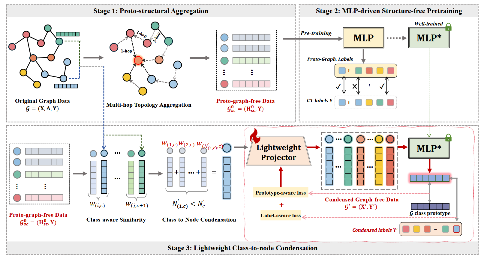

# LightGFC

Research code for **Lightweight Graph-Free Condensation With MLP-Driven Optimization**.

Fuxin Yu, Xin Zheng, Yi Li, Yanqing Guo, Xikun Zhang, Jeffrey Chan, and Feng Xia.

[Framework](#framework) · [Installation](#installation) · [Quick start](#quick-start) · [Experiments](#experiments) · [Citation](#citation)

LightGFC compresses a graph into a small set of node features and labels for downstream node classification. It combines multi-hop feature aggregation, MLP pretraining, and class-to-node condensation. The condensed data does not require a learned adjacency matrix.

This repository provides six datasets, six downstream models, five method variants, and multi-seed evaluation with saved configurations and condensed tensors. Detailed protocols and implementation differences are documented in the [experiment guide](docs/experiments.md).

## Framework



The framework consists of three stages:

1. **Proto-structural aggregation:** combine multi-hop node features to capture information from the original graph topology.
2. **MLP-driven structure-free pretraining:** train an MLP using aggregated features and labeled training nodes.
3. **Lightweight class-to-node condensation:** initialize condensed nodes with class-aware similarity weights, then optimize them with label-aware and prototype-aware objectives through the frozen MLP.

Downstream models train on the condensed features and labels; message-passing models use identity adjacency during this training. Checkpoints are selected on the original validation split and evaluated on the original test split.

## Installation

Use **Python 3.11** for the documented environment. Runtime dependencies are pinned in [requirements.txt](requirements.txt), including PyTorch 2.7.1, PyTorch Geometric 2.6.1, and OGB 1.3.6.

```bash
git clone https://github.com/SoMiReMiReDo/LightGFC_.git
cd LightGFC_
python3.11 -m venv .venv
source .venv/bin/activate
python -m pip install -e .
```

For CUDA, install the appropriate **PyTorch 2.7.1** wheel before `pip install -e .`; see the [version-specific PyTorch installation instructions](https://pytorch.org/get-started/previous-versions/#v271). Select CPU with `--gpu -1` or a CUDA device with `--gpu 0`.

Alternatively, after cloning the repository, use Conda:

```bash
conda env create -f environment.yml
conda activate lightgfc
python -m pip install --no-deps -e .
```

## Quick start

Run a short Cora experiment on CPU to check the installation:

```bash
python -m lightgfc --dataset cora --ratio 0.026 --data-source official \
  --gpu -1 --mlp-epochs 5 --projector-epochs 5 --epochs 10
```

This command downloads Cora to `data/` and prints the result directory under `results/`. The reduced epoch counts are for a smoke test and should not be used for accuracy comparisons.

```bash
python -m lightgfc --help
```

The installed `lightgfc` command exposes the same interface. The original `main.py`, `mainWithAll.py`, and `mainWithout*.py` entry points are retained as CLI wrappers.

## Datasets

| Dataset (`--dataset`) | Setting | Official source | Condensation ratios | Ratio denominator |
| --- | --- | --- | --- | --- |
| Cora (`cora`) | Transductive | PyG Planetoid, public split | 0.013, 0.026, 0.052 | All nodes |
| CiteSeer (`citeseer`) | Transductive | PyG Planetoid, public split | 0.009, 0.018, 0.036 | All nodes |
| OGB-Arxiv (`arxiv`) | Transductive | OGB, official split | 0.0005, 0.0025, 0.005 | All nodes |
| Flickr (`flickr`) | Inductive | PyG Flickr | 0.001, 0.005, 0.01 | Training nodes |
| Reddit (`reddit`) | Inductive | PyG Reddit | 0.0005, 0.001, 0.002 | Training nodes |
| OGB-Products (`products`) | Transductive | OGB, official split | 0.00025, 0.0005, 0.001 | All nodes |

Ratios are fractions: `0.026` means 2.6%. The middle ratio is the default for each dataset. The condensed budget is the ratio times its denominator, rounded to the nearest integer; it must be at least the number of training classes and no larger than the number of labeled training nodes. Use `--ratio-base all` or `--ratio-base train` to override the denominator.

Use `--data-dir` to choose the cache directory. `--data-source official` explicitly selects PyG/OGB data. The default `auto` prefers local GraphSAINT-format files when available for Arxiv, Flickr, and Reddit; `legacy` requires those files. See [data preparation and split details](docs/experiments.md#data-and-experiment-settings) before comparing results across sources. Large datasets require sufficient host memory and disk space; OGB may request confirmation on the first Products download.

## Experiments

### Main node-classification experiment

Run the full LightGFC variant with GCN on Cora using seeds 0–9:

```bash
python -m lightgfc --dataset cora --ratio 0.026 --data-source official \
  --variant full --model gcn --gpu 0 --seed 0 --runs 10
```

Replace `--gpu 0` with `--gpu -1` for CPU execution. Repeat for the dataset/ratio combinations above to evaluate the LightGFC settings corresponding to Table II. To specify seeds individually, use, for example, `--seeds 0 1 2` **in place of** `--seed` and `--runs`.

The default configuration uses 200 MLP epochs, 300 projector epochs, and 256 hidden units. Downstream training uses 1,500 epochs for Cora, CiteSeer, and Arxiv, and 2,000 for Flickr, Reddit, and Products. `--hops 3` averages the input, one-hop, and two-hop features. Dataset-specific loss weights and all other settings are described in the [experiment guide](docs/experiments.md#implementation-choices-and-comparison-with-the-paper).

### Downstream models

Supported `--model` values are `gcn`, `mlp`, `sage`, `sgc`, `gin`, and `jknet`. For example:

```bash
python -m lightgfc --dataset cora --ratio 0.026 --data-source official \
  --model sage --gpu 0 --runs 10
```

### Ablation studies

| `--variant` | Prototype alignment | Label adaptation | Similarity weighting |
| --- | --- | --- | --- |
| `full` | Yes | Yes | Yes |
| `no-label` | Yes | No | Yes |
| `no-prototype` | No | Yes | Yes |
| `no-both` | No | No | Yes |
| `no-similarity` | Yes | Yes | No |

```bash
for variant in full no-label no-prototype no-both no-similarity; do
  python -m lightgfc --dataset cora --ratio 0.026 --data-source official \
    --variant "$variant" --gpu 0 --runs 10
done
```

See the [paper experiment mapping](docs/experiments.md#main-results-and-ablations) for the settings used in Tables III–V, including the hop-count sweep.

### Reproducibility and current results

Training uses training labels only, with validation-based checkpoint selection. Accuracy is reported as the mean and sample standard deviation across seeds. Data source, resolved settings, actual budget, seeds, and software versions are saved with every invocation. Sparse CUDA operations may introduce small differences across devices and software versions.

**The current implementation does not reproduce all reported paper scores.** The [existing verification record](docs/experiments.md#verification) reports **78.33% ± 0.93%** for Cora/GCN at ratio 0.026 over seeds 0–9 on macOS CPU with pinned dependencies; Table II reports **90.6% ± 0.9%** for that setting. This record is a reference result, not a guarantee for other environments. See the [implementation differences](docs/experiments.md#implementation-choices-and-comparison-with-the-paper) before making comparisons. External baselines and the paper's additional downstream tasks are outside this repository's current scope.

## Saved outputs

Each invocation creates a separate directory under `results/`, or the path provided by `--output-dir`.

| File | Contents |
| --- | --- |
| `config.json` | Resolved configuration, data source, split sizes, budget, seeds, device, software versions, and class-label mapping |
| `runs.csv` | Per-seed validation-selected epoch, validation/test accuracy (%), condensation time, and peak allocated CUDA memory when applicable |
| `summary.json` | Mean test accuracy (%), sample standard deviation, and mean condensation time; standard deviation is `null` for one seed |
| `condensed-seed-<seed>.pt` | Condensed CPU tensors `x` (features) and `y` (labels) |

Condensation timing includes aggregation, MLP pretraining when enabled, and node initialization/projection; downloading and downstream model training are excluded. The `class_ids` field in `config.json` maps condensed labels back to source classes. See [output details](docs/experiments.md#outputs).

## Repository structure

| Path | Purpose |
| --- | --- |
| `lightgfc/cli.py`, `lightgfc/config.py` | CLI, argument validation, and dataset defaults |
| `lightgfc/datasets.py`, `lightgfc/graph.py` | Data loading, splits, and sparse graph preprocessing |
| `lightgfc/condensation.py` | Aggregation, MLP pretraining, and condensation |
| `lightgfc/models.py`, `lightgfc/evaluation.py` | Downstream models and evaluation |
| `lightgfc/experiment.py`, `lightgfc/artifacts.py` | Multi-seed execution and saved artifacts |
| `docs/experiments.md`, `docs/assets/` | Experiment protocol and framework figure |
| `tests/test_protocol.py` | Offline regression tests |
| `CITATION.cff` | Machine-readable citation metadata |

## Tests and issue reports

Run the offline regression tests from the repository root after installation:

```bash
python -m unittest discover -s tests -v
```

For questions or reproducibility issues, open a [GitHub issue](https://github.com/SoMiReMiReDo/LightGFC_/issues) with the command, commit hash, environment/device, data source, and relevant logs or saved configuration.

## Citation

If you use LightGFC in your research, please cite *Lightweight Graph-Free Condensation With MLP-Driven Optimization*. Citation metadata is available in [CITATION.cff](CITATION.cff). Until complete publication metadata is available, the following entry identifies the accompanying manuscript:

```bibtex
@misc{yu2026lightgfc,
  title  = {Lightweight Graph-Free Condensation With {MLP}-Driven Optimization},
  author = {Yu, Fuxin and Zheng, Xin and Li, Yi and Guo, Yanqing and
            Zhang, Xikun and Chan, Jeffrey and Xia, Feng},
  year   = {2026},
  note   = {Accompanying manuscript for LightGFC},
  url    = {https://github.com/SoMiReMiReDo/LightGFC_}
}
```

## License

A software license has not yet been specified. License selection is pending maintainer confirmation.
