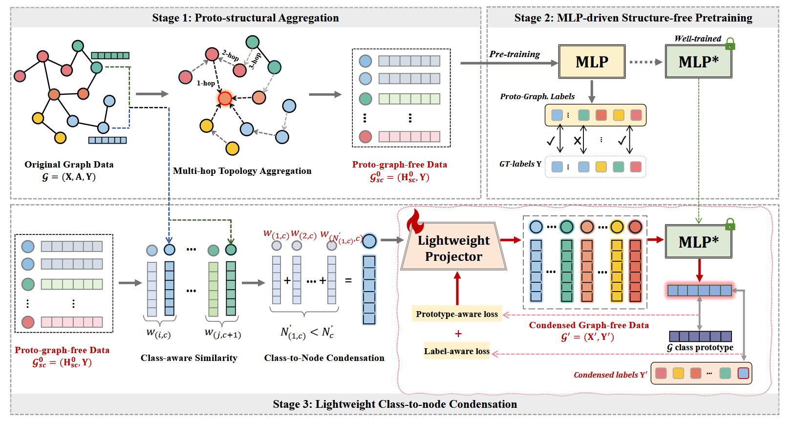

# LightGFC experiments



## Data and experiment settings

| Dataset | Split and default source | Table II ratios (fractions) | Ratio base |
| --- | --- | --- | --- |
| Cora | Transductive, PyG Planetoid public | 0.013, 0.026, 0.052 | All nodes |
| CiteSeer | Transductive, PyG Planetoid public | 0.009, 0.018, 0.036 | All nodes |
| Arxiv | Transductive, OGB official | 0.0005, 0.0025, 0.005 | All nodes |
| Flickr | Inductive, PyG Flickr | 0.001, 0.005, 0.01 | Training nodes |
| Reddit | Inductive, PyG Reddit | 0.0005, 0.001, 0.002 | Training nodes |
| Products | Transductive, OGB official | 0.00025, 0.0005, 0.001 | All nodes |

For transductive datasets, aggregation uses the original topology with training labels only. For inductive datasets, aggregation and evaluation use separate induced graphs for train, validation, and test. Graphs are made undirected, with duplicate edges collapsed. Arxiv and Reddit feature standardization fits only on training nodes. Source details are available in the [PyG dataset reference](https://pytorch-geometric.readthedocs.io/en/2.6.1/modules/datasets.html) and the [OGB dataset reference](https://ogb.stanford.edu/docs/nodeprop/).

For the GraphSAINT layout used by the original scripts, place `adj_full.npz`, `feats.npy`, `role.json`, and `class_map.json` in `data/ogbn-arxiv/`, `data/flickr/`, or `data/reddit/`. The archives are linked from the [GCond data instructions](https://github.com/ChandlerBang/GCond#download-datasets). The default `--data-source auto` uses these files when present. Use `--data-source official` to choose the PyG or OGB source explicitly, or `--data-source legacy` to require local GraphSAINT files. Larger datasets need disk space for the downloads and processed caches as well as host memory for sparse preprocessing. OGB may prompt on the first Products download. Populate that cache in an interactive run before launching unattended jobs.

The default ratio is the middle entry for the dataset. Following the GCond ratio convention, the budget is the requested fraction times the applicable base, rounded to the nearest integer. `--ratio-base train` or `--ratio-base all` can override that convention. Each training class receives at least one condensed node. Configurations that require more condensed nodes than labeled training nodes are rejected. See the [GCond ratio convention](https://github.com/ChandlerBang/GCond#run-the-code).

### Main results and ablations

For the LightGFC column of Table II, run the full GCN experiment for each dataset and ratio above with `--runs 10`. For Table III model comparisons, use `--model mlp`, `gcn`, `sage`, `sgc`, `gin`, or `jknet` with Cora at 0.026, Arxiv at 0.005, and Reddit at 0.002.

```bash
python -m lightgfc --dataset cora --ratio 0.026 --gpu 0 --runs 10
```

For Table IV, run the variants below at the middle ratio for each of Cora, CiteSeer, Arxiv, Flickr, and Reddit. For Table V, sweep `--hops` from 1 to 5 using Cora at 0.026, CiteSeer at 0.018, Arxiv at 0.0005, Flickr at 0.001, and Reddit at 0.0005. The hop count includes the input feature term, so `--hops 3` averages the input, one-hop, and two-hop features.

| `--variant` | Prototype alignment | Label adaptation | Similarity weighting |
| --- | --- | --- | --- |
| `full` | On | On | On |
| `no-label` | On | Off | On |
| `no-prototype` | Off | On | On |
| `no-both` | Off | Off | On |
| `no-similarity` | On | On | Off |

```bash
for variant in full no-label no-prototype no-both no-similarity; do
  python -m lightgfc --dataset cora --ratio 0.026 --variant "$variant" --gpu 0 --runs 10
done
```

### Implementation choices and comparison with the paper

The public scripts and manuscript differ in several details. This release follows the manuscript's three stages, training-only supervision, validation-based checkpoint selection, and graph-free downstream training. Class-to-node initialization uses `1 - cosine_similarity`, class-normalized weights, and seeded groups of near-equal size. The no-similarity variant uses uniform node weights and class-frequency budgets. The projector is an identity-initialized learnable matrix over the condensed nodes, so its storage grows quadratically with the condensed budget.

The manuscript provides loss-weight search ranges. This release uses `alpha = beta = 0.5` on Cora, CiteSeer, and Arxiv and `0.005` on Flickr, Reddit, and Products. It uses 200 MLP epochs, 300 projector epochs, 256 hidden units, and 1,500 downstream epochs for Cora, CiteSeer, and Arxiv or 2,000 for the other datasets. MLP training shuffles labeled nodes into batches of up to 8,192. Validation runs at the first and last epochs and every 10 epochs by default. Earlier checkpoints win ties. Use `--seeds`, `--alpha`, `--beta`, and `--eval-every` to specify a different protocol.

The reported paper scores use a historical experiment setup. Differences in the data caches, hyperparameters, initialization, and checkpoint selection can change the scores with this implementation. The repository covers the LightGFC node-classification runs. The paper's external baselines and additional downstream tasks require their own implementations.

## Outputs

Each invocation creates a separate subdirectory of `results/` (or `--output-dir`) and prints its path.

- `config.json` records resolved settings, data source, split sizes, actual budget, seeds, and software versions.
- `runs.csv` records validation-selected epoch, validation and test accuracy in percent, and condensation time per seed. On CUDA it also records peak allocated CUDA bytes during condensation.
- `condensed-seed-<seed>.pt` contains the CPU tensors `x` and `y`. The `class_ids` list in `config.json` maps each condensed label to its source class. Downstream message-passing models receive identity adjacency with these tensors.
- `summary.json` reports test mean and sample standard deviation in percent. The standard deviation is null for a single seed.

Condensation timing covers graph aggregation, MLP pretraining when enabled, and node initialization and projection. It excludes downloading and downstream model training. Sparse CUDA operations can produce small differences across devices and software versions.

## Verification

The full Cora GCN run at 0.026 with seeds 0–9 scored 78.33% ± 0.93% on macOS CPU using the pinned dependencies. Table II reports 90.6% ± 0.9% for that setting.

See the [project README](../README.md) for installation and regression tests.
